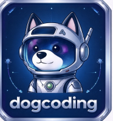

<div align="center">

# 🎬 漫剧老李 · AIGC 短剧 / 漫剧全流程 Skill

**把「一句话需求」变成「能直接投喂的成片提示词」**

`V8.2.0-SLIM` 精简套装版 · Short-Drama Director Suite

> 1 总控 + 10 子技能 · 四层纵深 · 53 份规则库 · 机检 C1~C41 · Seedance 2.5 / 2.0


</div>

<div align="center">

| ① 立项锁 | ② 剧本 | ③ 资产 | ④ 分镜 | ⑤ 投喂 | ⑥ 质检 |
|:---:|:---:|:---:|:---:|:---:|:---:|
| 五道锁 + I 画风锁 | 六阶段门控 + 圆桌 | 先锁后拍 · 五宫格 | 文武三轨 · 故事板 | 七段式 + 接线单 | C1~C41 + G1~G8 |

</div>

> **版本**：V8.2.0-SLIM 精简套装版（Suite）· 在全量版基础上**删去海外剧剧本（`sd-overseas-engine`）与解说叙事（`sd-jieshuo-engine`）两条赛道及〇·0 赛道分流锁**，其余判据一条未改。改动与验收记录见 [`short-drama-director/CHANGELOG.md`](short-drama-director/CHANGELOG.md)。

---

## 🧭 这是什么

一套**给 AI 助手执行的 AIGC 全流程创作规则库**（OpenClaw Skill / Agent 技能包）。不是一份长提示词，而是一套**可路由、可挂载、可机检**的导演系统：**1 个总控**（`short-drama-director`）+ **10 个子技能**（`sd-*-engine`），**四层纵深**。

> **核心理念**：**用户看到 5 个问题，AI 内部跑 100 条规则。**
> 用户只回答「① 做什么 ② 从哪来 ③ 用什么模型 ④ 什么画幅 ⑤ 要什么结果」——锁、路由、子技能挂载、机检全部由总控内部完成，**不需要手动调用任何子技能**（但五道锁必须弹出来让你勾）。

它解决 AIGC 创作里最痛的三件事：

| 痛点 | 解法 | 结果 |
|:---|:---|:---|
| **人设/场景一镜一变** | Asset-First：角色 / 场景 / 道具**先锁定再进分镜**，CHR/AUD/PRP/SCN 台账 + 空间坐标复述 | 跨镜、跨段、跨集不漂移 |
| **生成完才发现不能投** | **五道前置锁 + 投喂必查清单 + P0~P2 门禁 + 稿件级机检 C1~C41** | 错误拦在生成之前，少烧算力 |
| **拼不出可投喂的稿** | 输出**七段式**结构化提示词 + 《素材接线单》，整组复制即喂 | 从「想法」到「能跑」零改写 |

> 🔑 **本包不持有图**：交付的是「**提示词 + 接线说明书**」。图由你在即梦 / Seedance / 豆包等平台自行生成并持有。素材按**存在形态**分三档：**M0 纯提示词 / M1 编号占位（默认）/ M2 已入库**，**每次交付首行声明形态**。

## 🎯 适用场景

管线与题材解耦，凡「**剧本 → 分镜 → 视频模型投喂**」的 AIGC 创作都可套用：

- **AI 短剧 / 漫剧 / 短视频剧集**（本包最典型的高密度场景）
- **AI 广告片 / 品牌宣传片 / 概念片**
- **分镜预演（PREVIS）与动态分镜** · **武打 / 动作场面设计**（现代格斗 / 武侠 / 仙侠 / 二次元 / 科幻）
- **情绪戏 / 微表情专项**（FACS 表情工程）
- 任何需要**跨镜头角色一致性**的 AI 视频生产

---

## 🧩 四层纵深架构（1 总控 + 10 子技能）

<table>
<thead>
<tr><th align="center" width="90">层</th><th align="left" width="220">技能</th><th align="left">职责</th></tr>
</thead>
<tbody>
<tr><td align="center"><b>L0 总控</b></td><td><code>short-drama-director</code></td><td>素材来源 · <b>素材形态 M0/M1/M2</b> · 锁系统 · <b>53 份规则库</b>（含 style-bible 8 份）· 七段式 · 机检 <b>C1~C26</b>（增量主码 C27~C41）· P0~P2 门禁</td></tr>
<tr><td align="center"><b>L1 决策</b></td><td><code>sd-decision-engine</code></td><td>情境映射 E01~E15 + 80/15/5 权重 + 情绪锚点表 + 构图雷区双态白名单——回答「这场戏该用什么镜头」</td></tr>
<tr><td align="center" rowspan="7"><b>L2 生产</b></td><td><code>sd-recon-engine</code></td><td>素材采风与对标情报（只交付《对标情报卡》，不做打分 / 聚簇 / 定时抓取）</td></tr>
<tr><td><code>sd-script-engine</code></td><td>剧本创作与小说改编（六阶段编剧链 + 五席圆桌审核 + 台词七维诊断 + 拟人化引擎 + 外来剧本润色层）</td></tr>
<tr><td><code>sd-asset-engine</code></td><td>资产锁定（三清单 · 场景五宫格 · 道具单实例锁 · 人群调度 · 按素材形态产出 + 接线单）</td></tr>
<tr><td><code>sd-storyboard-engine</code></td><td>文戏 / 日常戏分镜（★故事板图 · 剧情分镜格 · 段内衔接 5 维 / 运镜 5 模式）</td></tr>
<tr><td><code>sd-combat-engine</code></td><td>通用打戏分镜（摄影机行为锁 · 战场群战速查 · F1~F7 七层打斗架构）</td></tr>
<tr><td><code>sd-xuanhuan-engine</code></td><td>玄幻仙侠打戏（黄金颗粒度 · 双向攻防 · 收束闭环 · 法武合一招式库）</td></tr>
<tr><td><code>sd-real-engine</code></td><td>真人写实打戏（R1 克制档 · 11 环动力链 · 真实格斗招式库 · 多人战斗调度）</td></tr>
<tr><td align="center" rowspan="2"><b>L3 交付</b></td><td><code>sd-feed-engine</code></td><td>输出 A/B/C 三模式 + <b>投喂层闸门 G1~G8</b>（编号一致性 + 素材形态一致性 + 方案 C+/C++ 双图职责）+ 素材映射 + 《素材接线单》+ 多段衔接</td></tr>
<tr><td><code>sd-qc-engine</code></td><td>成片质检与连续性管理（一致性台账 · 剪辑转场 · 声音设计 · 后期音乐与 BGM Cue Sheet · 出稿机检）</td></tr>
</tbody>
</table>

## 🔒 五道前置锁 + I 画风锁

> 动手前**全部弹出让你勾选**。任何一道未指定，**必须停下询问并把选项摆出来**——禁止默认跳过、禁止替用户推断。这是硬门，不是建议。

| 锁 | 选项 | 说明 |
|:---:|:---|:---|
| **〇·1 素材来源** | ① 原创 ② 改编 ③ 对标爆款 ④ 热点速成 | 第一道锁；③④ 先挂 `sd-recon-engine` 出《对标情报卡》 |
| **A 模型版本** | ① Seedance 2.5 ② Seedance 2.0 | **二选一**，锁定后语法契约彻底分流 |
| **B 画幅** | ① 16:9 ② 9:16 ③ 21:9 | 与模型版本同规格前置锁定，未指定不动笔 |
| **C 交付形态** | ① 离线看板 ② md ③ 两者都交付 | **强制锁 · 未指定 = 停下询问** |
| **D 段缝衔接** | ① 末帧定格 ② 换机位硬切 ③ 空镜过渡 ④ 技巧型转场 | 多段任务四选一，四项独立弹出、禁止合并 |
| **I 画风锁** | 候选卡勾选（含「按你的推荐走」） | 导演风格卡，选定即冻结 |

> 另含**动作强度三档定档**：`R1 写实克制` / `R2 商业高燃（默认）` / `R3 玄幻大招`。

---

## 🔥 V8.2.0 升级了什么

<table>
<thead>
<tr><th align="left" width="150">方向</th><th align="left">本次升级</th></tr>
</thead>
<tbody>
<tr><td><b>🎬 分镜逻辑</b></td><td>新增<b>文武三轨</b>权威：纯文戏 6–8 镜长呼吸、一镜一完整物理动作、文转武三段起势链、5–8 人群像四步调度骨架；实拍复盘防怪七锁（反派站桩 / 破障瞬移 / 特写闭眼大头照 / 跨段背靠背连说 等）</td></tr>
<tr><td><b>🖼️ 场景资产</b></td><td>升级为 <b>16:9 五宫格</b>场景拼接图（左 2/3 室内无剖面高角全景 + 右 1/3 纵向四向）；盲区墙与门空间闭环三铁律；白模轴测站位图</td></tr>
<tr><td><b>🧍 角色资产</b></td><td>纯格式平级二选一：<b>16:9 四格纯图板</b> / <b>3:2 八格拼版</b>，与画风锁 100% 正交；新增角色多元化引擎，四项同类排异防网红脸</td></tr>
<tr><td><b>📐 站位方案</b></td><td><b>双图方案 C+</b>（模板图 `@图1` + 彩棋白模 `@图2`）与 <b>二合一方案 C++</b>（单张实景 45° 等轴测，省一个图位）二选一互斥，`gate_check.py` 的 <code>G8-SCHEME-C</code> 硬检</td></tr>
<tr><td><b>✍️ 剧本层</b></td><td>可拍性四门禁 + 第 1 集五步极速进场 + 台词拟人化引擎（称呼系统 / 书面→口语 / 撒碎屑四法 / 机械化认症表）</td></tr>
<tr><td><b>✅ 机检</b></td><td><b>C1~C41</b>（子检查码共 104 条）+ 投喂闸门 G1~G8 + 包级自检 10 项一键跑</td></tr>
</tbody>
</table>

## ⚡ 核心能力一览

| 阶段 | 能力 | 说明 |
|:---:|:---|:---|
| 📥 **采风** | 对标情报 | 信源 T1 / T1.5 / T2 分级 · 采风四步 · 《对标情报卡》十三项 · 六条证据纪律 |
| ✍️ **剧本** | 六阶段编剧链 | 来源登记 → IP 与角色开发 → 开发圣经 → 分集规划 → 正式剧本 → 五席圆桌审核 |
| 📈 **情绪** | 12 节拍曲线 | 全片张力 0~10 量化 + 折线图脚本 + 峰值校验 |
| 🎙️ **台词** | 七维诊断 + 语速自检 | 三维语速档、超长句拆镜、金句气口；统一 `台词：【角色（语气）："…"】`，2.0 / 2.5 同规格 |
| 🖼️ **资产** | Asset-First 资产包 | 角色板 / 场景五宫格 / 道具图；CHR/AUD/PRP/SCN/Uxx 台账；A0~A3 按需触发 |
| 🎥 **空间** | 站位声明 + 分级 | 五要素 + 轴线锁 + 位移链；S0~S4；180° 轴线；人物账连续 · 摆位必入画 |
| 🎬 **分镜** | 文武双模 + 故事板图 | 文戏微表情六阶段 / 武戏 PREVIS；★故事板图（动作相位七态拆格）· 剧情分镜格 |
| ⚔️ **打戏** | 三大打戏引擎 | 通用 / 玄幻仙侠 / 真人写实——分域专精，总控不持有打戏规则 |
| 🚀 **投喂** | 七段式 | 【画幅风格】→【场景资产】→【核心人物】→【站位声明】→【时间轴分镜】→【音效】→【强制禁止项】 |
| 🚫 **禁令** | 禁令失效三改法 | 模型对否定不敏感、对词根敏感——换词 / 主体优先 / 触发器移除；`C28a~c 台词机械化` 探测亦在此层 |
| ✅ **质检** | 门禁 + 机检 | `validate_prompt.py` C1~C26（子检查码共 104 条，增量主码 C27~C41）+ `gate_check.py` 投喂闸门 |
| 🖥️ **看板** | 离线分镜看板 | 项目 md（唯一真相）→ 单文件 HTML，双击即开；可导出 SRT / 时间线 CSV / API JSON |
| 🎵 **声音** | 后期音乐与声音设计 | BGM Cue Sheet / 音乐搜索词 / AI 音乐提示词 / 版权检查 |
| 🛡️ **合规** | 安全转译词典 | 血腥断肢转译为「气浪震散 / 火花消散 / 重创定格」，降低平台风险（不承诺 100% 通过） |

## 🖥️ 适用平台与模型

| | 支持 |
|---|---|
| **Agent 平台** | OpenClaw · WorkBuddy · 豆包智能体 / 扣子（Coze）· Dify 及通用 LLM（支持豆包 JSON 分块，防上下文截断） |
| **视频模型** | **Seedance 2.5 / 2.0**（强制二选一，语法契约彻底分流；**包内唯一模型线**） |
| **输出** | 七段式投喂提示词组 · Canvas / API 结构化载荷 · 单文件离线看板 · 情绪曲线图 |

---

## ⚙️ 60 秒上手

> 📦 **部署**：仓库根目录**并列** 1 个总控（`short-drama-director/`）+ 10 个子技能（`sd-*-engine/`）。多技能平台（如 OpenClaw）把 **11 个目录整体同级部署**即可，主入口 = `short-drama-director`；只认单技能目录的平台，以 `short-drama-director/SKILL.md` 为主入口，并把子技能**同级**补齐。

```bash
# 1) 装进 OpenClaw（总控 + 10 子技能同级部署）
openclaw skills install ./short-drama-director --as short-drama-director

# 2) 包级自检（53 份规则库静态检查 + 语义回归）
python3 short-drama-director/scripts/check_package.py

# 3) 出稿质检（★一次跑完：投喂层闸门 + C 系机检，FAIL 清零才交付）
python3 sd-feed-engine/scripts/gate_check.py <稿>.md --model 2.5 --aspect 16:9

# 4) 契约核销（该交的东西交没交，与语法判据不重叠）
python3 short-drama-director/scripts/audit_contract.py <稿>.md

# 5) 项目 md → 单文件离线看板
python3 short-drama-director/scripts/build_board_lite.py <项目.md>
```

**给 AI 助手的最小执行序列**：读 `SKILL.md` → 完成**五道前置锁 + I 画风锁** → 定动作强度档（R1/R2/R3）→ 有对白先过语速自检 + 语气位 → 资产锁定 → 分镜 → 按 `★ prompt-feeding-checklist.md` 生成投喂词 → 跑 `validate_prompt.py` → 过 `quality-gate-review`。

### 🧮 常用指令

`/写剧本` · `/台词诊断` · `/数字资产包` · `/素材形态` · `/接线单` · `/做分镜` · `/语速自检` · `/生成视频提示词` · `/导出工作流参数` · `/情绪曲线` · `/看板` · `/微表情` · `/审查`

完整指令路由见 [`short-drama-director/SKILL.md`](short-drama-director/SKILL.md)

## 📦 项目结构

```
lixiaoxiao9888-create/manju-laoli-skill/        # V8.2.0-SLIM 精简套装（174 文件）
├── README.md                                   # 本落地页（中文 + English）
├── LICENSE / .gitignore
├── short-drama-director/                       # L0 总控（74 文件 · 53 份规则库 · 机检脚本）
│   ├── SKILL.md                                #   总控路由 + 工作法 + 模块索引
│   ├── references/                             #   53 份专业规则库（含 style-bible 画风锁知识库 8 份）
│   ├── scripts/                                #   check_package / validate_prompt / gate 等机检全家桶
│   └── README.md / LICENSE / CHANGELOG.md
├── sd-decision-engine/                         # L1 决策层（情境映射 E01~E15）
├── sd-recon-engine/                            # L2 生产层 · 素材采风
├── sd-script-engine/                           # L2 · 剧本（国内剧 + 外来剧本润色）
├── sd-asset-engine/                            # L2 · 资产锁定
├── sd-storyboard-engine/                       # L2 · 文戏分镜 + 故事板图
├── sd-combat-engine/                           # L2 · 通用打戏
├── sd-xuanhuan-engine/                         # L2 · 玄幻仙侠打戏
├── sd-real-engine/                             # L2 · 真人写实打戏
├── sd-feed-engine/                             # L3 交付层 · 投喂（投喂层闸门）
└── sd-qc-engine/                               # L3 · 质检 / 连续性 / 声音设计
```

## 📜 更新历史

- **V8.2.0-SLIM**（本轮）— **分镜与资产大升级**：新增文武三轨分镜逻辑与实拍复盘防怪七锁；场景升级 16:9 五宫格、角色四格 / 八格双板式（与画风锁正交）；站位方案 C+ / C++ 双分支落地；机检扩到 **C1~C41**（子码 104 条）；剧本层补可拍性四门禁与台词拟人化引擎。详见 [`CHANGELOG.md`](short-drama-director/CHANGELOG.md)。
- **V7.5.0-SLIM** — **瘦身**：删去海外剧（`sd-overseas-engine`）与解说叙事（`sd-jieshuo-engine`）两个子技能、赛道分流权威文件与〇·0 分流锁，子技能 **12 → 10**、六道锁 → **五道锁**；判据一条未改。
- **V7.4.26 P14**（2026-11-03）— 案例示例整体剔除 + 判据级去重 + 文档瘦身；出稿质检从三跑变一跑。
- **更早版本** — 见 [`short-drama-director/CHANGELOG.md`](short-drama-director/CHANGELOG.md)；旧版归档：[**manju-laoli-skill-legacy**](https://github.com/lixiaoxiao9888-create/manju-laoli-skill-legacy)。

---

## 🏆 赞助商

感谢以下赞助商对本项目的支持：

| LOGO | 类型 | 赞助商名称 | 说明 | 网站 |
| --- | --- | --- | --- | --- |
|  | 企业 | OmniBoard | 字字动画推出专业漫剧创作工具，从剧本到发行变现全渠道一站式，年卡 Seedance 2.5 低至 0.19/秒 | [omniboard.tv/register?ref=GITHUBADD7DZ](https://omniboard.tv/register?ref=GITHUBADD7DZ) |
|  | 企业 | 浮瑞万相AI | 浮瑞万相AI旗下喜马抓马 AI 视听全链路综合服务平台，HimaStudio 多模态 AI 视听创作平台及线上 OPC 社区 · 深度适配漫剧老李 Skill | [himadrama.com](https://www.himadrama.com) |
|  | 企业 | 点众 | 开放全 IP 库，超创与公司自制权限相同，可看到典藏版、爆款剧、精品剧的 IP | [点众开放 IP 库](https://vcnti1p0lovd.feishu.cn/wiki/W3zvwKqzJiVRDqkvooEckIZgnFh) |
|  | 企业 | DogCoding | 大模型 API 中转网关：统一标准化接口，聚合多家大模型，提供请求转发、协议转换、密钥管理、配额控制、用量统计、故障降级能力 | [dogcoding.cn](https://dogcoding.cn/) |
| *（LOGO 占位）* | — | 虚位以待 | 赞助位开放中——让你的产品出现在众多 AI 短剧创作者面前 | [联系我们](mailto:lixiaoxiao9888@gmail.com) |

> 💡 **招商说明**：赞助位对模型渠道、算力平台、API 服务商及创作团队开放。
> 合作请联系：邮箱 `lixiaoxiao9888@gmail.com` · 微信 `lisenlin998`

### 🎬 分镜引擎专项赞助用户

感谢以下用户赞助分镜引擎的开发（开放中）：

*你的头像将出现在这里。*

| 赞助用户 | 联系方式 |
| --- | --- |
| 汤圆（用老李 skills 出剧 · 包算力 · 包发行） | 微信：fush989 |

---
---

<div align="center">

# 🇬🇧 English Overview

## V8.2.0-SLIM · Short-Drama Director Suite

**An industrial, full-pipeline creation skill package for AIGC audiovisual works — from one-line brief to feed-ready prompts — built for AI agents / LLMs to call directly.**

`1 router + 10 sub-skills` · `4-layer architecture` · `53 rulebooks` · `C1~C41 lint` · `Seedance 2.5 / 2.0`


| ① Locks | ② Script | ③ Assets | ④ Storyboard | ⑤ Feed | ⑥ QC |
|:---:|:---:|:---:|:---:|:---:|:---:|
| 5 locks + I | 6 stages + review | asset-first · 5-grid | dual-mode · sheets | 7-section + wiring | C1~C41 + G1–G8 |

</div>

## 🧭 What This Is

An **AIGC creation rulebase for AI agents** (OpenClaw Skill / Agent skill package): **1 router** (`short-drama-director`) **+ 10 sub-skills** (`sd-*-engine`) **across four layers**.

> **Core idea:** **the user sees 5 questions; the AI runs 100 rules.** You only decide ① what to make ② where it comes from ③ model ④ aspect ratio ⑤ desired output. Locks, routing, sub-skill mounting and linting are handled internally — sub-skills are never called by hand.

It solves the three chronic problems of AIGC production:

| Problem | Solution | Result |
|:---|:---|:---|
| Characters/scenes drift between shots | **Asset-First**: lock characters, scenes and props before storyboarding | No drift across shots, segments, episodes |
| You discover it's not feedable only after rendering | **5 front-end locks + pre-feed checklist + P0–P2 gates + C1~C41 lint** | Errors caught before generation |
| Raw output can't be pasted into a model | **7-section** structured prompts + a wiring sheet | Zero rewriting from idea to render |

> 🔑 **The package holds no images** — it delivers prompts plus a wiring sheet. Images are generated and held by you on external platforms. Assets are graded by existence form: **M0 prompt-only / M1 numbered slots (default) / M2 registered**, declared on the first line of every delivery.

## 🎯 Use Cases

Genre-agnostic — anything that goes **script → storyboard → video-model feed**:

- **AI short dramas / animated shorts / short-form series** (the densest use case)
- **AI commercials / brand films / concept films**
- **Storyboard previsualization (PREVIS)** · **action & fight design** (modern, wuxia, xianxia, anime, sci-fi)
- **Emotional & micro-expression work** (FACS)
- Any AI video production needing **cross-shot character consistency**

## 🧩 Architecture

| Layer | Skill | Role |
|:---:|:---|:---|
| **L0 Router** | `short-drama-director` | Sourcing · **asset form M0/M1/M2** · lock system · **53 rulebooks** · 7-section format · lint **C1~C26** (+ C27–C41) · P0–P2 gates |
| **L1 Decision** | `sd-decision-engine` | Situation mapping E01–E15 + 80/15/5 weight + emotional anchors + composition whitelist |
| **L2 Production** | `sd-recon-engine` | Reference sourcing & benchmark intel (《Benchmark Card》 only) |
| | `sd-script-engine` | Screenwriting & adaptation (6-stage chain + 5-seat review + dialogue 7-dim + humanizing engine) |
| | `sd-asset-engine` | Asset locking (3 checklists · 5-grid scenes · prop single-instance lock · crowd direction) |
| | `sd-storyboard-engine` | Drama storyboarding (★storyboard sheet · plot-deduction grid · in-segment linking) |
| | `sd-combat-engine` | General fight storyboarding (camera behavior lock · F1–F7 fight architecture) |
| | `sd-xuanhuan-engine` | Xianxia / fantasy fight (golden granularity · bidirectional offense · closed-loop finishers) |
| | `sd-real-engine` | Live-action fight (R1 restrained tier · 11-link power chain · real techniques) |
| **L3 Delivery** | `sd-feed-engine` | Output modes A/B/C + **feed gates G1–G8** + material mapping + wiring sheet + multi-segment joining |
| | `sd-qc-engine` | Final QC & continuity (ledger · transitions · sound design · BGM cue sheet · lint) |

## 🔒 Five Front-End Locks + Style Lock

> All locks are offered for you to choose. **If a lock is unspecified, the system must stop and ask** — no defaults, no inferring.

| Lock | Options | Note |
|:---:|:---|:---|
| **〇·1 Sourcing** | ① original ② adaptation ③ benchmark ④ trend | First lock; ③④ mount `sd-recon-engine` |
| **A Model** | ① Seedance 2.5 ② Seedance 2.0 | Choose one; syntax contracts split |
| **B Aspect ratio** | ① 16:9 ② 9:16 ③ 21:9 | Locked together with the model |
| **C Delivery form** | ① offline board ② md ③ both | **Mandatory · unspecified = stop and ask** |
| **D Seam joining** | ① held end-frame ② camera swap ③ empty shot ④ creative transition | Four-way choice for multi-segment work |
| **I Style** | pick a candidate card (incl. "go with your recommendation") | Frozen once chosen |

> Action-intensity tiers: `R1 restrained` / `R2 commercial (default)` / `R3 fantasy`.

## 🔥 What's New in V8.2.0

- **Storyboard logic** — three-track (drama / transition / fight) authority: 6–8 shot long-breath dialogue scenes, one full physical action per shot, 5–8 person crowd blocking skeleton, plus seven anti-bug locks from live-shoot reviews.
- **Scene assets** — 16:9 five-grid scene sheets (2/3 interior panorama + 1/3 four-direction verticals) with blind-wall and door topology rules.
- **Character assets** — 16:9 four-panel or 3:2 eight-panel sheets, orthogonal to the style lock; diversity engine blocks template faces.
- **Blocking schemes** — **C+** (template `@img1` + color-chess white-model `@img2`) or **C++** (single 45° isometric scene, saving one image slot), enforced by `G8-SCHEME-C`.
- **Script layer** — shootability gates, five-step cold open, dialogue humanization engine.
- **Lint** — **C1~C41** (104 sub-codes) + feed gates G1–G8 + a 10-item package self-check.

## 🖥️ Platforms & Models

| | Support |
|---|---|
| **Agent platforms** | OpenClaw · WorkBuddy · Doubao Agent / Coze · Dify, plus generic LLMs |
| **Video models** | **Seedance 2.5 / 2.0** (mandatory choice — the only model line in this package) |
| **Outputs** | 7-section feed prompts · Canvas / API payloads · offline board · emotion curve |

## ⚙️ Quick Start

> 📦 **Deploy:** the repo root holds 1 router (`short-drama-director/`) + 10 sub-skills (`sd-*-engine/`) side by side — deploy all 11 directories at the same level; the main entry is `short-drama-director`.

```bash
openclaw skills install ./short-drama-director --as short-drama-director
python3 short-drama-director/scripts/check_package.py
python3 sd-feed-engine/scripts/gate_check.py <script>.md --model 2.5 --aspect 16:9
python3 short-drama-director/scripts/audit_contract.py <script>.md
python3 short-drama-director/scripts/build_board_lite.py <project.md>
```

## 📦 Structure

```
lixiaoxiao9888-create/manju-laoli-skill/        # V8.2.0-SLIM slim suite (174 files)
├── README.md                                   # landing (Chinese + English)
├── LICENSE / .gitignore
├── short-drama-director/                       # L0 router (74 files · 53 rulebooks · lint scripts)
├── sd-decision-engine/                         # L1 decision (E01–E15)
├── sd-recon-engine/                            # L2 · sourcing
├── sd-script-engine/                           # L2 · scriptwriting
├── sd-asset-engine/                            # L2 · asset locking
├── sd-storyboard-engine/                       # L2 · storyboard + storyboard sheets
├── sd-combat-engine/                           # L2 · general fight
├── sd-xuanhuan-engine/                         # L2 · xianxia fight
├── sd-real-engine/                             # L2 · live-action fight
├── sd-feed-engine/                             # L3 delivery · feed (feed-layer gates)
└── sd-qc-engine/                               # L3 · QC / continuity / sound
```

## 📜 Changelog

- **V8.2.0-SLIM** — storyboard & asset overhaul: three-track storyboard logic, 16:9 five-grid scenes, four/eight-panel character sheets, C+/C++ blocking schemes, C1~C41 lint, dialogue humanization engine.
- **V7.5.0-SLIM** — slim build: overseas-drama and explainer-narration tracks removed (12 → 10 sub-skills, six locks → five).
- **V7.4.26 P14** — worked examples removed, criteria de-duplicated, docs slimmed.
- **Earlier** — see [`short-drama-director/CHANGELOG.md`](short-drama-director/CHANGELOG.md). Legacy archive: [manju-laoli-skill-legacy](https://github.com/lixiaoxiao9888-create/manju-laoli-skill-legacy).

---

<div align="center">

## 📄 License

**MIT** · For creative & learning use; comply with platform content policies

**Made with ❤️ for AIGC Creators**

</div>

---

## 🙌 贡献者与团队

感谢参与产品设计、开发、测试、内容与社区建设的成员：

<table>
<tr>
<td width="50%" valign="top">
  
  <strong>老李<br><sub>项目发起者 · 总编导 · 微信：lisenlin998</sub></strong><br>
  <a href="mailto:lixiaoxiao9888@gmail.com">lixiaoxiao9888@gmail.com</a><br>
  <em>用作品说话。</em>
  <br clear="left">
</td>
<td width="50%" valign="top">
  
  <strong>evo<br><sub>格式支线贡献者 · GitHub：coco38622</sub></strong><br>
  <a href="https://github.com/coco38622">@coco38622</a><br>
  <em>让格式支线与官方文档逐字对齐。</em>
  <br clear="left">
</td>
</tr>
<tr>
<td width="50%" valign="top">
  <strong>JY<br><sub>子技能规范贡献者</sub></strong><br>
  <em>好故事，不分国界。</em>
  <br clear="left">
</td>
<td width="50%" valign="top">
  <em>虚位以待 —— 期待你加入。</em>
</td>
</tr>
</table>


## V8.2.0-SLIM 稳定性能力与边界

新增完整章节分页、JSON/text 统一门禁、多对白累计及 JSON 单源导出。使用单源项目时必读 `short-drama-director/references/project-bundle-contract.md`。导出仅含资产提示词与 P3CLEAN_GRID 计划；不是已生成图片，也不是已经过 P4 模型适配的投喂稿。旧示例回归和未解决项见包外交付说明，不以机检 PASS 代替语义与实拍验收。
